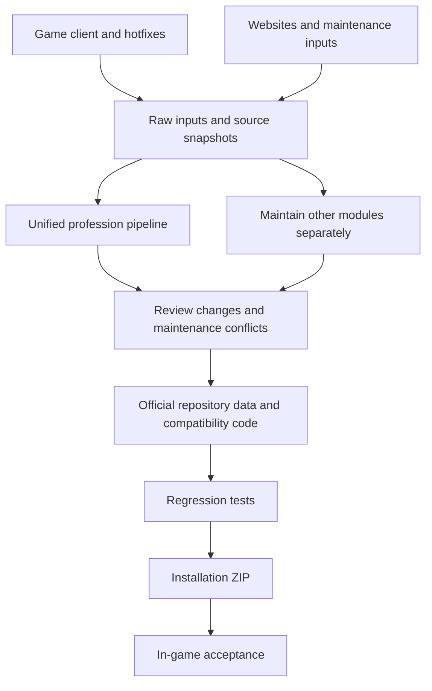

# DungeonsForever

[中文](README.md) | **English**

A native World of Warcraft Lua addon for dungeon, map, loot, quest, profession, gear, and class information. This README explains the maintainer workflow for updating source data, validating compatibility, and building an installation package after a game or source website update.

> [!IMPORTANT]
> The unified entry point, `df-data-pipeline/_temp/fc_update.py`, manages profession data. Dungeons, loot, gear, quests, class guides, and other modules still require separate maintenance. There is currently no single command that updates the entire addon.

## Contents

- [Update coverage](#update-coverage)
- [Requirements](#requirements)
- [Complete update workflow](#workflow)
- [Updating other modules](#other-modules)
- [Focused updates](#focused-updates)
- [Retaining a candidate batch and preview package](#preview)
- [Reports, archives, and recovery](#reports-and-recovery)
- [Release checklist](#release-checklist)
- [Repository layout and documentation](#documentation)

<a id="update-coverage"></a>
## Update coverage

| What changed | Required action | Managed by the profession entry point? |
| --- | --- | --- |
| Game client Build / Hotfix | Export three client CSVs and a matching nine-table DB2 snapshot; pass them explicitly to the generator | Reads, audits, and generates; does not export |
| ForeverChanges profession pages | Fetch, parse, preserve maintenance changes, and generate profession data in three languages | Yes |
| Trainer, recipe learning, and specialization web evidence | Refresh web evidence and check it against client teaching relationships; retain unknown states | Yes |
| Ordinary material vendors, shelves, stock, and quotes | Refresh suppliers and complete shelves; generate independent material supply data | Yes |
| Recipe-item vendor offers, stock, prices, and coordinates | First generate vendor / NPC CSVs with `scripts/gen_vendors.py` | Reads the prepared CSVs only |
| NPC reputation faction affiliation | Generate JSON and an evidence bundle with `scripts/update_vendor_factions.py` | Reads the prepared evidence only |
| Dungeons, loot, quests, gear, BIS, guides, PvP, collections, and more | Update the relevant inputs, generators, or maintenance configuration | No; see [other modules](#other-modules) |
| Auctionator auction prices and quantities | Perform searches or scans in the game, then manually recalculate routes | No; these are runtime observations |
| Game API / UI compatibility | Adapt the affected Lua modules and verify them in the game | No; data generation does not adapt application code |

The profession entry point generates six base datasets and their `zhTW` / `enUS` versions: `Professions`, `ProfRecipes`, `ProfLeveling`, `ProfGathering`, `ProfVendors`, and `ProfTrainers`. It also processes shared item, specialization, and ordinary material supply data.

Independent extensions such as recipe quests, specialization quests, mining, fishing, and profession tools are not overwritten by the six-table generation step. Review them under their own maintenance rules. [DungeonsForever.toc](DungeonsForever.toc) is the source of truth for the addon version.



<a id="requirements"></a>
## Requirements

- Windows, Windows PowerShell 5.1, Git, `curl.exe`, and Python 3.10+.
- Python dependencies from [df-data-pipeline/requirements.txt](df-data-pipeline/requirements.txt), including a Lua 5.1 runtime, OpenCC, and Playwright.
- An installed Chrome or Edge browser for online browser collection; configure proxies for the actual environment.
- Client exports additionally require a repository-local wow.tools.local runtime with the intended Forever client loaded. Website updates alone do not require that service.

The currently authorized source workspace for this project is:

```text
C:\Users\yewei\Downloads\DungeonsForever\DungeonsForever
```

Keep source changes, generated data, tests, caches, logs, staging files, and packages in this repository. The addon copy in the game installation is a read-only comparison reference; the tools in this guide do not deploy there. The user installs the package after completing release checks.

For first-time dependency setup, run in PowerShell:

```powershell
Set-Location 'C:\Users\yewei\Downloads\DungeonsForever\DungeonsForever'
$dfRoot = (Get-Location).Path
$dfRuntime = Join-Path $dfRoot '.pipeline-runtime'
New-Item -ItemType Directory -Force -Path "$dfRuntime\lib", "$dfRuntime\tmp", "$dfRuntime\pip-cache" | Out-Null
$env:PIP_CACHE_DIR = Join-Path $dfRuntime 'pip-cache'
$env:TEMP = Join-Path $dfRuntime 'tmp'
$env:TMP = $env:TEMP
$env:PYTHONPATH = (Join-Path $dfRuntime 'lib') + [IO.Path]::PathSeparator + $env:PYTHONPATH
python -B -m pip install --target "$dfRuntime\lib" -r df-data-pipeline/requirements.txt
if ($LASTEXITCODE -ne 0) { throw 'Dependency installation failed.' }
```

Use the same PowerShell session for the following steps. When changing Python versions, prepare dependencies for that interpreter, particularly the matching Lupa binary package.

<a id="workflow"></a>
## Complete update workflow

**Run steps 1 and 4–9 for every update. Add step 2 when client data changes, and step 3 when recipe-item vendor information changes.** Step 5 also reviews non-profession modules; rebuild those modules when their relevant sources change.

### 1. Save a baseline and initialize this run

```powershell
Set-Location 'C:\Users\yewei\Downloads\DungeonsForever\DungeonsForever'
$dfRoot = (Get-Location).Path
$env:PYTHONPATH = (Join-Path $dfRoot '.pipeline-runtime\lib') + [IO.Path]::PathSeparator + $env:PYTHONPATH
$dfInputRecord = Join-Path $dfRoot '.pipeline-runtime\last-update-inputs.json'
$dfInputArgs = @()
if (Test-Path -LiteralPath $dfInputRecord) {
  $dfInputArgs = @(Get-Content -LiteralPath $dfInputRecord -Raw -Encoding UTF8 | ConvertFrom-Json)
}
$dfItemCsv = Join-Path $dfRoot 'df-data-pipeline\_temp\_fc\inputs\client\item.csv'
$dfSavedItemArg = [Array]::LastIndexOf($dfInputArgs, '--item-csv')
if ($dfSavedItemArg -ge 0) { $dfItemCsv = $dfInputArgs[$dfSavedItemArg + 1] }
git status --short
git diff --stat
```

Commit or back up existing work first, leaving an identifiable recovery point. Record the client Build / Hotfix, source website dates, and intended release version. Preserve maintenance changes and execution records.

`$dfInputArgs` holds explicit input arguments for this run. It starts empty on the first run, selecting repository defaults. After successful publication, step 6 saves the selection; the next initialization restores it so a website-only refresh does not unintentionally use older default CSVs. When this run appends an existing option again, its last value wins. Do not reset the array after appending input arguments.

<a id="client-export"></a>
### 2. Export fresh client inputs after a game update

Confirm that wow.tools.local has loaded the intended client. Do not switch versions or reload caches during export. The exporter downloads and verifies the corresponding Hotfix. If the game has updated before a website does, retain each source's actual version instead of relabeling old evidence.

The following example saves all three CSVs and the nine-table snapshot in a new repository-local batch, preserving previous inputs. `$dfDb2` must not exist or must be empty; do not populate it with an older snapshot first.

```powershell
$dfBatchID = Get-Date -Format 'yyyyMMdd-HHmmss-fff'
$dfBatch = Join-Path $dfRoot ".pipeline-runtime\updates\$dfBatchID"
$dfClient = Join-Path $dfBatch 'client'
$dfDb2 = Join-Path $dfBatch 'db2'
New-Item -ItemType Directory -Force -Path $dfClient | Out-Null
powershell.exe -NoProfile -ExecutionPolicy Bypass -File scripts/export_buyprice/export-item-buy-prices.ps1 `
  -OutputPath "$dfClient\item-buy-prices.csv" `
  -ItemOutputPath "$dfClient\item.csv" `
  -RecipeItemOutputPath "$dfClient\recipe-item-specializations.csv" `
  -LearningSnapshotPath $dfDb2
if ($LASTEXITCODE -ne 0) { throw 'Client export failed.' }
$dfItemCsv = Join-Path $dfClient 'item.csv'
$dfInputArgs += @(
  '--prices-csv', (Join-Path $dfClient 'item-buy-prices.csv'),
  '--item-csv', $dfItemCsv,
  '--recipe-items-csv', (Join-Path $dfClient 'recipe-item-specializations.csv'),
  '--db2-dir', $dfDb2
)
```

Keep all of the following together:

- `item-buy-prices.csv`: item names in three languages, base bundle purchase prices, bundle sizes, and versions.
- `item.csv`: item classifications and complete raw fields.
- `recipe-item-specializations.csv`: recipe-item teaching relationships and learning prerequisite evidence.
- The DB2 directory: nine raw tables and `manifest.json`, including Build, Hotfix identity, and file hashes.

The same Build does not guarantee the same Hotfix. All three CSVs must match the DB2 snapshot. **Exporting new files does not change the pipeline's default inputs.** Use the arguments above for both checking and publication. To replay the batch later, keep using the matching arguments or formally maintain the default snapshots and input manifest.

See the [client exporter guide](scripts/export_buyprice/README.md) for full options and table definitions. The default tool directory is `.pipeline-runtime/wow.tools.local/`. The unified profession entry point does not invoke this exporter.

<a id="vendor-refresh"></a>
### 3. Refresh recipe-item vendors and NPC affiliations

First preview the item scope:

```powershell
python -B scripts/gen_vendors.py --item-db2 $dfItemCsv --keep-books --plan
if ($LASTEXITCODE -ne 0) { throw 'Vendor collection plan failed.' }
```

Then write new vendor / NPC CSVs to a separate batch. The example uses `--proxy=` for a direct connection. When a proxy is needed, provide the actual address to the collection commands, such as `--proxy=http://127.0.0.1:7897`. Chrome is the default browser; add `--channel msedge` to use Edge.

```powershell
$dfVendorID = Get-Date -Format 'yyyyMMdd-HHmmss-fff'
$dfVendorDir = Join-Path $dfRoot ".pipeline-runtime\vendor-updates\$dfVendorID"
New-Item -ItemType Directory -Force -Path $dfVendorDir | Out-Null
$dfVendorsCsv = Join-Path $dfVendorDir 'vendors.csv'
$dfNpcsCsv = Join-Path $dfVendorDir 'npcs.csv'
python -B scripts/gen_vendors.py --item-db2 $dfItemCsv --keep-books --refetch --workers 1 --proxy= `
  --csv-out $dfVendorsCsv --npcs-out $dfNpcsCsv
if ($LASTEXITCODE -ne 0) { throw 'Vendor collection failed.' }
```

`--keep-books` includes the book subclass in collection; teaching and purchasing eligibility still require independent evidence. `--refetch` forces a refresh. For routine rolling collection, use cache age options described in the [vendor tool guide](scripts/README.md).

Use the same new vendor CSV to refresh reputation faction affiliation for all relevant NPCs and freeze the supporting evidence:

```powershell
$dfFactionArgs = @(
  '--vendors-csv', $dfVendorsCsv,
  '--output-dir', (Join-Path $dfVendorDir 'affiliations'),
  '--locales', 'enUS,zhCN,zhTW'
)
python -B scripts/update_vendor_factions.py @dfFactionArgs --collect --refresh --proxy=
if ($LASTEXITCODE -ne 0) { throw 'Vendor affiliation collection failed.' }
$dfInputArgs += @(
  '--vendors-csv', $dfVendorsCsv,
  '--npcs-csv', $dfNpcsCsv,
  '--vendor-factions-json', (Join-Path $dfVendorDir 'affiliations\npc-factions.json')
)
```

If a verified client Faction export is available, append `--client-dir` and its directory to `$dfFactionArgs` before execution. See the [independent faction exporter](scripts/export_npc_factions/README.md). Without client evidence, collection uses this run's web evidence and existing locale catalogs only. Confirmed ID and translated-name coverage may decrease; review the audit.

These examples select explicit inputs without installing them as defaults. If updating the default affiliation input, `--install-input` installs affiliation JSON, audits, and the evidence bundle only. **It does not also install vendor CSVs or generate Lua.** See the [affiliation update workflow](scripts/VENDOR_FACTIONS.md). Reputation faction affiliation, Alliance / Horde access, and merchandise reputation requirements are separate facts. Missing values remain unknown.

### 4. Check profession data online

```powershell
python -B df-data-pipeline/_temp/fc_update.py @dfInputArgs --check --refresh-trainers --refresh-catalog
if ($LASTEXITCODE -ne 0) { throw 'Profession update check failed. Review the report before continuing.' }
```

This refreshes profession pages, trainer and supplementary catalog evidence, ordinary material suppliers, and their shelves. It merges the selected inputs with maintenance changes, then validates Lua, record preservation, and TOC loading in three languages. `--refresh-trainers` / `--refresh-catalog` request fresh evidence for those web sources; ordinary online runs also follow each layer's cache policy.

By default, client and recipe-item vendor snapshots come from `df-data-pipeline/_temp/_fc/inputs/`. The entry point does not watch `scripts/` output folders or start wow.tools.local. See the [input inventory](df-data-pipeline/SCRIPT_INPUTS.md) for roles and options.

`--check` does not publish official data, but it may write caches, staging files, cooldown state, and reports. The console prints the report path at the end. Inspect failed / degraded material collection counts, not just the process exit status.

### 5. Review differences, maintenance conflicts, and other modules

Review additions, removals, field changes, provenance, versions, translations, and supplier coverage. Pay particular attention to:

- Recipe thresholds, output quantities, reagents, recipe items, and trainer learning paths.
- Conflicts between upstream changes and maintenance overrides, or unexpected record loss.
- Missing translations and whether existing translations still match source identities and hashes.
- Whether quotes describe gold-only bundles and evidenced supply; a base purchase price alone does not prove vendor availability.
- Failed material NPC collection: historical shelves do not continue granting eligibility in that run. Review any resulting reduction in available NPC quotes.
- Records with missing links, unverified versions, or absent coordinates remaining unknown.

Change profession maintenance inputs and regenerate; do not patch generated Lua directly. The relevant locations are:

| Content | Maintenance location |
| --- | --- |
| Profession additions, field corrections, thresholds, ordering, and omission rules | `df-data-pipeline/_temp/_fc/maintenance/professions.json` |
| Profession translations and source text versions | `df-data-pipeline/_temp/_fc/maintenance/locales.json` |
| Ordinary material seeds, supplier directory, and disable rules | `df-data-pipeline/_temp/_fc/maintenance/material-vendors.json` |
| Independent profession tool requirements | `Core/Data/Data_ProfTools.lua`, maintained manually outside the generated recipe catalog |

See the [maintenance guide](df-data-pipeline/MANUAL_MAINTENANCE.md) and [material supply guide](df-data-pipeline/MATERIAL_VENDORS.md). When changed source data invalidates a preservation rule, review it individually instead of removing conflict checks to force publication.

Also review source changes and perform necessary updates for [other modules](#other-modules). Unchanged modules can be retained, but a profession update report does not demonstrate that those modules were updated.

### 6. Publish profession data to the repository

After the check passes and differences have been reviewed, publish with the same `$dfInputArgs`:

```powershell
python -B df-data-pipeline/_temp/fc_update.py @dfInputArgs --apply --refresh-trainers --refresh-catalog
if ($LASTEXITCODE -ne 0) { throw 'Profession publication failed.' }
New-Item -ItemType Directory -Force -Path (Split-Path $dfInputRecord -Parent) | Out-Null
ConvertTo-Json -InputObject @($dfInputArgs) | Set-Content -LiteralPath $dfInputRecord -Encoding UTF8 -ErrorAction Stop
git diff --stat
```

Publication collects and validates online again, so its output is not guaranteed to be byte-identical to the preceding check. To retain a particular candidate, use a [candidate batch and preview ZIP](#preview). Input / target hash mismatches or validation failures block the transaction. Publication uses compensated rollback.

> [!WARNING]
> `--offline` replays existing inputs and snapshots; it does not fetch updates. An online `--check` does not publish the new normalized material snapshot. Following it with `--apply --offline` may replay old material supply, so it does not establish that the newly checked shelves were published. Use the online publication command above for this run's online update.

The unified entry point does not rewrite the five default input CSVs. The PowerShell example additionally saves arguments to `last-update-inputs.json` for step 1 to restore. When invoking the entry point directly, supply the matching inputs yourself. The argument record stores paths, not a data backup, and does not replace archiving the original files.

### 7. Check compatibility, versioning, and regressions

After a game update, review `GetBuildInfo()`, client gating, item / quest / profession APIs, Auctionator interfaces, UI behavior, and events. Update the TOC `Interface` declarations when appropriate; declarations alone do not adapt changed APIs.

Set the release version in the TOC's `## Version`. Preserve TOC / XML dependency order, the shared `ns` contract, locale overlays, and SavedVariables migrations. Once all affected modules are updated, run:

```powershell
python -B tests/run_tests.py
if ($LASTEXITCODE -ne 0) { throw 'Regression tests failed.' }
git diff --check
if ($LASTEXITCODE -ne 0) { throw 'Whitespace validation failed.' }
```

The complete suite should have no failures or errors; explain any skipped tests. Do not reuse an older release's test count as the current result. See the [test guide](tests/README.md) for the runner and acceptance boundaries.

### 8. Build the installation package

```powershell
.\package_addon.bat --no-pause
if ($LASTEXITCODE -ne 0) { throw 'Packaging failed.' }
```

The packager reads current official runtime files, TOC / XML references, and assets. It creates `DungeonsForever-<version>-<timestamp>.zip` in the repository root and prints its file count, size, and SHA-256. The top-level ZIP folder is `DungeonsForever/`; generators, tests, caches, and development documentation are excluded.

Packaging does not refresh sources, generate data, or run regression tests. Before release, verify the ZIP member list, extraction / CRC, version, and content equality with the tested source files. Save the printed SHA-256. The source commit, input identities, test logs, and package should identify the same release batch.

### 9. Install and verify in the game

The user should exit the game, back up the previous addon and relevant SavedVariables, then install the ZIP's `DungeonsForever/` folder under the intended client's `Interface/AddOns/`. Preserve `DungeonsForeverDB`; data updates do not require clearing settings, exclusions, routes, or crafting history. Re-enter the game. During development, `/reload` can reload already installed files.

- Open `/df` and check the version, main pages, and Lua errors.
- Verify affected dungeons, loot, quests, maps, and all three locale presentations.
- Open the character's own profession window so actual client data becomes available.
- Perform actual Auctionator searches / scans at the auction house to refresh prices and quantities.
- Manually recalculate affected profession routes, then check shopping lists, NPC / AH sources, and the HUD.
- Verify actual crafting, progress persistence, and reload recovery; confirm existing execution facts remain intact.

Offline simulations and ZIP checks do not prove in-game APIs, live stock, actual crafting, UI layout, or frame timing. Record any outstanding real-client acceptance items explicitly in the release notes.

<a id="other-modules"></a>
## Updating other modules

The following is maintenance navigation, **not a batch execution order**. Historical tools may contain old absolute paths, one-time patches, or incremental writes. Before running them, check current inputs, outputs, dependencies, locale overlays, and official targets. Correct generated datasets through their inputs / generators rather than replacing a reproducible process with output edits.

| Module | Main entry points / references | What to verify |
| --- | --- | --- |
| Dungeon structure, entrances, and areas | `gen_dungeon_entry.py`, `gen_area_map.py`, and incremental records | Stable dungeon IDs, map IDs, and entrance coordinates |
| Dungeon routes and map pins | `_route_plan/tune.html`, `gen_route_lua.py`, `fc_pins.py` | Maintained routes, faction branches, and coordinates |
| Boss models, positions, and abilities | `gen_boss_model.py`, `gen_boss_pos.py`, `gen_boss_skills.py` | NPC / spell identities, positions, and descriptions |
| Dungeon loot and dungeon quests | Multi-script chains for the corresponding tables in `INDEX.md` | Source additions / removals, quest endpoints, and linked IDs |
| Class quests | `gen_class_quest.py` and `samples/ClassQuestsForever/` | Input snapshots, quest chains, and locale content |
| Gear, vendors, and rare sources | `gen_gear_src.py`, `gen_gear_pack.py`, `gen_gear_scrape.py`, and related tools | Stats, acquisition sources, and relationship coverage |
| BIS, class guides, and rankings | `fc_bis.py`, `fc_guide.py`, `fc_tier.py` | Source text, class / specialization identities, and translations |
| Raid sets, PvP, and reputation | `gen_raidsets.py`, `gen_pvp_data.py`, `gen_pvp_honor.py`, `gen_factions_data.py`, and related tools | Source versions, values, and maintenance rules |
| Collections, exploration, NPC locations, and independent profession extensions | Respective generators, explicit maintenance configuration, and historical increments | New content, coordinates, quest conditions, and maintenance changes |

Scripts are generally under `df-data-pipeline/_temp/`. See the [dataset index](df-data-pipeline/INDEX.md) for the full mapping and [architecture guide](ARCHITECTURE.md) for code, loading order, and SavedVariables contracts. `df-prof-pipeline-v1.0/` is retired. Old `sync_beta.py`, `mk_df_*`, and historical patch scripts are not routine update steps.

<a id="focused-updates"></a>
## Focused updates

These are check commands. To publish after reviewing the result, replace `--check` with `--apply`, retaining the same inputs and online / offline choice. Add the relevant explicit arguments when selecting new CSVs instead of unintentionally using default older inputs.

```powershell
python -B df-data-pipeline/_temp/fc_update.py --materials-only --check
python -B df-data-pipeline/_temp/fc_update.py --specializations-only --check
python -B df-data-pipeline/_temp/fc_update.py --from-csv df-data-pipeline/_temp/_fc/data/DataProfItems.csv --check
python -B df-data-pipeline/_temp/fc_update.py --check --offline
```

| Scope | Behavior |
| --- | --- |
| `--materials-only` | Refresh ordinary material supply; does not collect recipe-item vendor CSVs |
| `--specializations-only` | Rebuild specialization data from matching client CSVs / DB2 and web evidence; does not export client tables |
| `--from-csv` | Rebuild item Lua from an existing fixed 19-column CSV; does not refresh websites, client inputs, or material supply; affiliation JSON remains an independent input |
| `--offline` | Strictly replay existing evidence; fail if required caches or matching evidence are missing instead of connecting automatically |

`df-data-pipeline/run.bat` accepts the same arguments. Use the entry point's `--help` for the complete option list.

<a id="preview"></a>
## Retaining a candidate batch and preview package

To retain candidate data and inspect installation contents without replacing official repository data:

```powershell
$dfPreviewID = Get-Date -Format 'yyyyMMdd-HHmmss-fff'
python -B df-data-pipeline/_temp/fc_update.py @dfInputArgs --check `
  --stage-dir ".pipeline-runtime/review/$dfPreviewID" `
  --package-zip "dist/DungeonsForever-data-preview-$dfPreviewID.zip"
if ($LASTEXITCODE -ne 0) { throw 'Preview generation failed.' }
```

Both targets must be absent, and these options cannot be combined with `--apply`. The candidate directory retains generated outputs, audits, and input hashes. The ZIP uses this run's candidate profession Lua and the current repository's other runtime files. It does not update other modules or run the complete regression suite.

This example checks online. Add `--offline` only to replay already saved evidence. Preview generation does not replace official data or success pointers. There is currently no command that directly promotes the staging directory; official publication still requires `--apply` and fresh validation.

<a id="reports-and-recovery"></a>
## Reports, archives, and recovery

| Path | Purpose |
| --- | --- |
| `df-data-pipeline/_temp/_fc/reports/unified/run-*.json` | Run status, changed files, validation results, material collection, and errors |
| `df-data-pipeline/_temp/_fc/maintenance/` | Version-controlled maintenance rules and source revisions |
| `df-data-pipeline/_temp/_fc/inputs/manifest.json` | Provenance and hashes for default imported inputs |
| `.pipeline-runtime/updates/`, `.pipeline-runtime/vendor-updates/` | Raw input batches created by this guide's examples |
| `.pipeline-runtime/last-update-inputs.json` | Input arguments saved by these examples after the most recent successful publication and restored at initialization |
| `.pipeline-runtime/review/`, `dist/` | Candidate outputs and preview packages |
| `.implementation-backup/pipeline-publish-*` | Transaction recovery material; use the path reported on failure |

Caches, reports, `.pipeline-runtime/`, and installation ZIPs are normally Git-ignored. A source commit alone does not back up client snapshots, original web responses, evidence bundles, or packages. Archive those files and the actual arguments separately when offline replay is required. Keep material snapshots together with the raw pages they reference.

On failure, inspect the current report and retain logs first. Confirm no update process is still running before retrying. Do not publish concurrently or clear caches to bypass locks, version mismatches, or hash errors. If rollback is incomplete, inspect the recovery directory named in the report. Restore an identified source / data batch without overwriting unrelated uncommitted work or modifying game SavedVariables.

<a id="release-checklist"></a>
## Release checklist

- [ ] Saved the pre-update baseline and recorded the target client and source versions.
- [ ] Matched the selected CSVs, DB2 snapshot, vendor data, and affiliation evidence; saved the actual arguments.
- [ ] Reviewed every affected module, including those outside the profession entry point.
- [ ] Reviewed maintenance changes, locales, removals, unknowns, and degraded material collection.
- [ ] Published successfully; TOC version and compatibility code match the changes.
- [ ] Passed the current full regression suite and `git diff --check`; explained any skipped tests.
- [ ] Verified ZIP contents, integrity, version, and equality with tested sources; archived SHA-256.
- [ ] Completed in-game acceptance or explicitly recorded the remaining real-client checks.

<a id="documentation"></a>
## Repository layout and documentation

```text
DungeonsForever/
├── DungeonsForever.toc      # Version, client declarations, and loading order
├── Core/                   # Lua application code and UI
│   └── Data/               # Official data and enUS / zhTW overlays
├── Locales/                # Interface text
├── Libs/                   # Bundled libraries
├── Media/                  # Maps, images, and other runtime assets
├── df-data-pipeline/       # Unified profession pipeline and historical module tools
├── scripts/                # Independent client / vendor / NPC data producers
├── tests/                  # Offline regressions and acceptance records
├── package_addon.bat       # Packager for current official runtime files
├── README.md               # Chinese maintenance workflow
└── README.en.md            # English maintenance workflow
```

- [Architecture and change navigation](ARCHITECTURE.md)
- [Unified profession pipeline](df-data-pipeline/README.md)
- [Script and input mapping](df-data-pipeline/SCRIPT_INPUTS.md)
- [Dataset and generator index](df-data-pipeline/INDEX.md)
- [Maintenance records](df-data-pipeline/MANUAL_MAINTENANCE.md)
- [Ordinary material vendors and purchase eligibility](df-data-pipeline/MATERIAL_VENDORS.md)
- [Recipe-item vendor collection](scripts/README.md)
- [NPC affiliation updates](scripts/VENDOR_FACTIONS.md)
- [Tests and acceptance records](tests/README.md)

See [LICENSE](LICENSE) for copyright and terms covering original content. Third-party resources retain their respective licenses.
