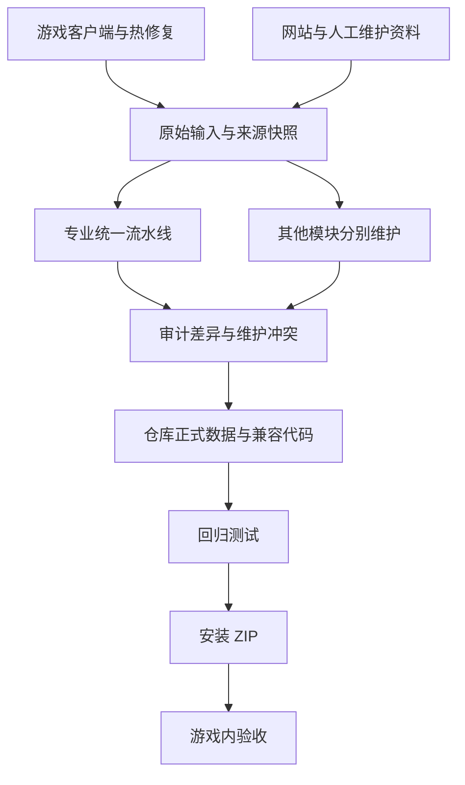

# DungeonsForever · 无限副本手册

**中文** | [English](README.en.md)

原生 World of Warcraft Lua 插件，提供副本、地图、掉落、任务、专业、装备与职业资料。本 README 面向维护者，说明游戏更新或来源网站更新后，如何更新数据、验证代码并生成安装包。

> [!IMPORTANT]
> 当前统一入口 `df-data-pipeline/_temp/fc_update.py` 负责专业数据。副本、掉落、装备、任务、职业攻略等仍需按模块维护；目前没有覆盖整个插件的一键更新命令。

## 目录

- [更新覆盖范围](#update-coverage)
- [环境准备](#requirements)
- [完整更新流程](#workflow)
- [其他模块如何更新](#other-modules)
- [只更新某一类数据](#focused-updates)
- [生成候选批次和预览安装包](#preview)
- [报告、归档与恢复](#reports-and-recovery)
- [发布检查清单](#release-checklist)
- [目录与参考文档](#documentation)

<a id="update-coverage"></a>
## 更新覆盖范围

| 触发变化 | 更新动作 | 是否由专业统一入口负责 |
| --- | --- | --- |
| 游戏客户端 Build / Hotfix | 导出同轮客户端三份 CSV 和九表 DB2 快照，再显式传入生成器 | 负责读取、审计和生成，不负责导出 |
| ForeverChanges 专业页面 | 在线抓取、解析、保留人工修订并生成三语专业表 | 是 |
| 训练师、配方学习途径和专精网页证据 | 刷新网页并与客户端教学关系核对，保留未知状态 | 是 |
| 普通材料商人的货架、库存与报价 | 刷新供应商和完整货架，生成独立材料供货表 | 是 |
| 图纸商人的供货、库存、价格与坐标 | 先用 `scripts/gen_vendors.py` 生成商人 / NPC CSV | 只读取生成好的 CSV |
| NPC 所属声望阵营 | 用 `scripts/update_vendor_factions.py` 生成 JSON 和证据包 | 只读取生成好的资料 |
| 副本、掉落、任务、装备、BIS、指南、PvP、收藏等 | 更新对应输入、生成器或人工维护配置 | 否，见[其他模块](#other-modules) |
| Auctionator 拍卖行行情与数量 | 在游戏里实际搜索或扫描，再手动重算路线 | 否，属于运行时观测 |
| 游戏 API / 界面兼容性 | 修改对应 Lua 业务模块并实机验证 | 否，数据生成不能代替代码适配 |

专业统一入口生成六类基础表及其 `zhTW` / `enUS` 版本：`Professions`、`ProfRecipes`、`ProfLeveling`、`ProfGathering`、`ProfVendors`、`ProfTrainers`；同时处理共享的物品、专精和普通材料供货数据。

任务图纸、专精任务、采矿、钓鱼和专业工具等独立扩展不由上述六表生成过程覆盖。它们需要按照各自维护规则核对。插件的当前版本以 [DungeonsForever.toc](DungeonsForever.toc) 为准。



<a id="requirements"></a>
## 环境准备

- Windows、Windows PowerShell 5.1、Git、`curl.exe` 和 Python 3.10+。
- Python 依赖以 [df-data-pipeline/requirements.txt](df-data-pipeline/requirements.txt) 为准，包含 Lua 5.1 运行库、OpenCC 和 Playwright。
- 在线浏览器采集需要已安装的 Chrome 或 Edge；代理地址按实际环境配置。
- 客户端数据导出另外需要仓库内的 wow.tools.local 运行目录，并加载要更新的 Forever 客户端。网页更新本身不要求启动这个服务。

当前项目获准写入的源码目录为：

```text
C:\Users\yewei\Downloads\DungeonsForever\DungeonsForever
```

所有源码、数据、测试、缓存、日志、暂存和压缩包都在该仓库内处理。游戏安装目录中的插件副本仅作只读比较；本文工具不向该目录部署。安装由使用者在完成发布检查后执行。

首次准备依赖时，在 PowerShell 执行：

```powershell
Set-Location 'C:\Users\yewei\Downloads\DungeonsForever\DungeonsForever'
$dfRoot = (Get-Location).Path
$dfRuntime = Join-Path $dfRoot '.pipeline-runtime'
New-Item -ItemType Directory -Force -Path "$dfRuntime\lib", "$dfRuntime\tmp", "$dfRuntime\pip-cache" | Out-Null
$env:PIP_CACHE_DIR = Join-Path $dfRuntime 'pip-cache'
$env:TEMP = Join-Path $dfRuntime 'tmp'
$env:TMP = $env:TEMP
$env:PYTHONPATH = (Join-Path $dfRuntime 'lib') + [IO.Path]::PathSeparator + $env:PYTHONPATH
python -B -m pip install --target "$dfRuntime\lib" -r df-data-pipeline/requirements.txt
if ($LASTEXITCODE -ne 0) { throw 'Dependency installation failed.' }
```

后续步骤使用同一个 PowerShell 会话。更换 Python 版本时，应重新准备与该解释器匹配的依赖，尤其不要混用不同 Python 版本的 Lupa 二进制包。

<a id="workflow"></a>
## 完整更新流程

**每次都执行第 1、4–9 步；游戏数据变化时补第 2 步，图纸商人资料变化时补第 3 步。** 第 5 步同时核对非专业模块，只有相关来源发生变化时才重建对应模块。

### 1. 保存基线并初始化本轮参数

```powershell
Set-Location 'C:\Users\yewei\Downloads\DungeonsForever\DungeonsForever'
$dfRoot = (Get-Location).Path
$env:PYTHONPATH = (Join-Path $dfRoot '.pipeline-runtime\lib') + [IO.Path]::PathSeparator + $env:PYTHONPATH
$dfInputRecord = Join-Path $dfRoot '.pipeline-runtime\last-update-inputs.json'
$dfInputArgs = @()
if (Test-Path -LiteralPath $dfInputRecord) {
  $dfInputArgs = @(Get-Content -LiteralPath $dfInputRecord -Raw -Encoding UTF8 | ConvertFrom-Json)
}
$dfItemCsv = Join-Path $dfRoot 'df-data-pipeline\_temp\_fc\inputs\client\item.csv'
$dfSavedItemArg = [Array]::LastIndexOf($dfInputArgs, '--item-csv')
if ($dfSavedItemArg -ge 0) { $dfItemCsv = $dfInputArgs[$dfSavedItemArg + 1] }
git status --short
git diff --stat
```

先将已有工作提交或备份，留下明确的回退点。记录本轮客户端 Build / Hotfix、来源网站日期及拟发布版本；保留已有手工修订和执行存档。

`$dfInputArgs` 保存本轮输入的显式参数。首次运行时为空，读取仓库默认输入；第 6 步成功发布后会保存选择，下次初始化时自动读回，避免仅刷新网站却误用旧默认 CSV。本轮追加同名参数时，以最后一个值为准。不要在后续步骤中重新清空已经追加的参数。

<a id="client-export"></a>
### 2. 游戏更新后，重新导出客户端输入

先在 wow.tools.local 确认加载的是目标客户端，导出期间不要切换版本或重载缓存。导出器会下载并核验对应 Hotfix；目标游戏刚更新而网站尚未跟进时，保留两者各自的真实版本，不给旧证据改标签。

下面将三份 CSV 和九表快照存入仓库内的新批次目录，避免覆盖上一批输入。`$dfDb2` 目录必须不存在或为空；不要预先复制旧快照到该位置。

```powershell
$dfBatchID = Get-Date -Format 'yyyyMMdd-HHmmss-fff'
$dfBatch = Join-Path $dfRoot ".pipeline-runtime\updates\$dfBatchID"
$dfClient = Join-Path $dfBatch 'client'
$dfDb2 = Join-Path $dfBatch 'db2'
New-Item -ItemType Directory -Force -Path $dfClient | Out-Null
powershell.exe -NoProfile -ExecutionPolicy Bypass -File scripts/export_buyprice/export-item-buy-prices.ps1 `
  -OutputPath "$dfClient\item-buy-prices.csv" `
  -ItemOutputPath "$dfClient\item.csv" `
  -RecipeItemOutputPath "$dfClient\recipe-item-specializations.csv" `
  -LearningSnapshotPath $dfDb2
if ($LASTEXITCODE -ne 0) { throw 'Client export failed.' }
$dfItemCsv = Join-Path $dfClient 'item.csv'
$dfInputArgs += @(
  '--prices-csv', (Join-Path $dfClient 'item-buy-prices.csv'),
  '--item-csv', $dfItemCsv,
  '--recipe-items-csv', (Join-Path $dfClient 'recipe-item-specializations.csv'),
  '--db2-dir', $dfDb2
)
```

必须同时保留：

- `item-buy-prices.csv`：三语物品名、基础整组购买价、组数与版本。
- `item.csv`：物品分类及完整原始字段。
- `recipe-item-specializations.csv`：图纸教学关系与学习前置证据。
- DB2 目录：九份原始表和 `manifest.json`，包含 Build、Hotfix 身份及文件哈希。

同一 Build 不代表同一 Hotfix，三份 CSV 必须匹配本轮 DB2 快照。**只导出新文件不会自动切换流水线默认输入。** 上面的参数需要同时用于检查和发布；以后重放这批数据也要继续使用匹配参数，或正式维护默认快照及输入清单。

完整参数与九表说明见[客户端导出器](scripts/export_buyprice/README.md)。默认工具目录为 `.pipeline-runtime/wow.tools.local/`；统一专业入口本身不会调用该导出器。

<a id="vendor-refresh"></a>
### 3. 图纸商人资料变化后，刷新商人和所属组织输入

先预演本次物品范围：

```powershell
python -B scripts/gen_vendors.py --item-db2 $dfItemCsv --keep-books --plan
if ($LASTEXITCODE -ne 0) { throw 'Vendor collection plan failed.' }
```

再把新商人 / NPC CSV 输出到独立批次。示例的 `--proxy=` 表示直连；需要代理时，给采集命令传入实际地址，例如 `--proxy=http://127.0.0.1:7897`。默认浏览器为 Chrome，使用 Edge 时增加 `--channel msedge`。

```powershell
$dfVendorID = Get-Date -Format 'yyyyMMdd-HHmmss-fff'
$dfVendorDir = Join-Path $dfRoot ".pipeline-runtime\vendor-updates\$dfVendorID"
New-Item -ItemType Directory -Force -Path $dfVendorDir | Out-Null
$dfVendorsCsv = Join-Path $dfVendorDir 'vendors.csv'
$dfNpcsCsv = Join-Path $dfVendorDir 'npcs.csv'
python -B scripts/gen_vendors.py --item-db2 $dfItemCsv --keep-books --refetch --workers 1 --proxy= `
  --csv-out $dfVendorsCsv --npcs-out $dfNpcsCsv
if ($LASTEXITCODE -ne 0) { throw 'Vendor collection failed.' }
```

`--keep-books` 将书籍子类纳入采集范围，教学和采购资格仍需独立证据。`--refetch` 强制刷新；日常滚动采集可改用缓存期限参数，见[商人工具说明](scripts/README.md)。

使用同一份新商人 CSV 刷新全部相关 NPC 的所属声望阵营，并冻结来源证据：

```powershell
$dfFactionArgs = @(
  '--vendors-csv', $dfVendorsCsv,
  '--output-dir', (Join-Path $dfVendorDir 'affiliations'),
  '--locales', 'enUS,zhCN,zhTW'
)
python -B scripts/update_vendor_factions.py @dfFactionArgs --collect --refresh --proxy=
if ($LASTEXITCODE -ne 0) { throw 'Vendor affiliation collection failed.' }
$dfInputArgs += @(
  '--vendors-csv', $dfVendorsCsv,
  '--npcs-csv', $dfNpcsCsv,
  '--vendor-factions-json', (Join-Path $dfVendorDir 'affiliations\npc-factions.json')
)
```

已有经验证的客户端 Faction 导出时，在执行前向 `$dfFactionArgs` 增加 `--client-dir` 及该目录；其生成方法见[独立所属阵营导出器](scripts/export_npc_factions/README.md)。未提供客户端证据时，仅使用本轮网页和现有语言目录，确认 ID 和译名的覆盖可能减少，应核对审计结果。

上述示例使用显式输入，不安装为默认资料。需要更新默认所属输入时，`--install-input` 只安装所属 JSON、审计与证据包，**不会顺带安装商人 CSV 或生成 Lua**。详见[所属组织更新流程](scripts/VENDOR_FACTIONS.md)。所属声望阵营、联盟 / 部落访问限制、商品声望条件是不同信息，缺失项继续保留未知。

### 4. 在线检查专业数据

```powershell
python -B df-data-pipeline/_temp/fc_update.py @dfInputArgs --check --refresh-trainers --refresh-catalog
if ($LASTEXITCODE -ne 0) { throw 'Profession update check failed. Review the report before continuing.' }
```

本步骤刷新专业网页、训练师和辅助目录证据、普通材料供应商及货架，合并本轮输入和人工维护，再检查 Lua、记录保留与三语 TOC 加载。`--refresh-trainers` / `--refresh-catalog` 要求刷新相应网页证据；普通在线运行也会按各层缓存规则工作。

默认读取 `df-data-pipeline/_temp/_fc/inputs/` 中的客户端与图纸商人快照，不监控 `scripts/` 的输出目录，也不启动 wow.tools.local。详细角色与参数见[输入清单](df-data-pipeline/SCRIPT_INPUTS.md)。

`--check` 不发布正式数据，但可以写入缓存、暂存、冷却状态和报告。控制台最后会打印本轮报告路径；检查材料采集的失败 / 降级数量，不能只看命令是否成功。

### 5. 审核差异，处理维护冲突和其他模块

核对报告中的新增、删除、字段变化、来源、版本、译文和供应商覆盖，重点检查：

- 配方门槛、产出数量、材料、图纸和训练师学习途径是否变化。
- 上游变化是否与现有人工修订冲突，已有记录是否意外消失。
- 新增原文是否缺译，既有人工译文是否仍匹配原文身份和哈希。
- 报价是否属于纯金币、整组和有证据的供货；基础购买价本身不证明 NPC 出售资格。
- 本轮材料 NPC 抓取失败时，其历史货架不会继续提供资格；这可能减少可用 NPC 报价，需要明确核对。
- 没有关联、版本未核验或缺坐标的记录是否继续保留为未知。

专业修订应写入维护输入后重新生成，不直接修改生成的 Lua。入口分别为：

| 内容 | 维护位置 |
| --- | --- |
| 专业新增、字段修订、阈值、顺序和省略规则 | `df-data-pipeline/_temp/_fc/maintenance/professions.json` |
| 专业人工译文及源文版本 | `df-data-pipeline/_temp/_fc/maintenance/locales.json` |
| 普通材料种子、供应商目录与停用规则 | `df-data-pipeline/_temp/_fc/maintenance/material-vendors.json` |
| 独立专业工具要求 | `Core/Data/Data_ProfTools.lua`，人工维护，不属于生成配方目录 |

具体差异处理见[人工维护说明](df-data-pipeline/MANUAL_MAINTENANCE.md)和[材料供货说明](df-data-pipeline/MATERIAL_VENDORS.md)。来源变化使保留规则失效时，应逐项复核；不要删除冲突检查来强行发布。

同时完成[其他模块](#other-modules)的来源核对和必要更新。没有变化的模块可以保留，但不能把专业更新报告当作这些模块已经更新的证据。

### 6. 发布专业数据到仓库

检查通过并处理差异后，使用相同的 `$dfInputArgs` 发布：

```powershell
python -B df-data-pipeline/_temp/fc_update.py @dfInputArgs --apply --refresh-trainers --refresh-catalog
if ($LASTEXITCODE -ne 0) { throw 'Profession publication failed.' }
New-Item -ItemType Directory -Force -Path (Split-Path $dfInputRecord -Parent) | Out-Null
ConvertTo-Json -InputObject @($dfInputArgs) | Set-Content -LiteralPath $dfInputRecord -Encoding UTF8 -ErrorAction Stop
git diff --stat
```

发布会再次在线采集和校验，结果不保证与上一次检查逐字节相同；需要留住某次候选内容时，使用[候选批次和预览 ZIP](#preview)。输入 / 目标哈希或结构校验失败会阻止事务，发布过程使用补偿回滚。

> [!WARNING]
> `--offline` 只重放已有输入和快照，不获取最新数据。在线 `--check` 不发布新的规范材料快照；随后改用 `--apply --offline` 可能重放旧材料供货，不能据此声称发布了刚检查的新货架。需要本轮在线更新时，按上面的在线发布命令执行。

统一入口不会自动改写五份默认 CSV。上面的 PowerShell 示例额外保存参数到 `last-update-inputs.json`，供第 1 步恢复；直接调用入口时，仍需自行传入匹配的输入。参数记录只保存路径，不包含数据备份，不能替代原始文件归档。

### 7. 检查代码兼容性、版本与回归测试

游戏更新还要核对 `GetBuildInfo()`、客户端门禁、物品 / 任务 / 专业 API、Auctionator 接口、界面及事件行为。需要时更新 `DungeonsForever.toc` 的 `Interface`；仅修改声明不能完成 API 适配。

在 TOC 的 `## Version` 设置本次插件版本；保留 TOC / XML 依赖顺序、`ns` 共享契约、三语覆盖和存档迁移。全部模块更新完成后执行：

```powershell
python -B tests/run_tests.py
if ($LASTEXITCODE -ne 0) { throw 'Regression tests failed.' }
git diff --check
if ($LASTEXITCODE -ne 0) { throw 'Whitespace validation failed.' }
```

完整测试应无失败、无错误，任何跳过项都要说明。不要把旧发布记录中的测试数量作为当前结果。测试入口和验收边界见[测试说明](tests/README.md)。

### 8. 生成安装包

```powershell
.\package_addon.bat --no-pause
if ($LASTEXITCODE -ne 0) { throw 'Packaging failed.' }
```

打包脚本读取当前正式运行文件、TOC / XML 引用和资源，生成仓库根目录下的 `DungeonsForever-<版本>-<时间戳>.zip`，并打印文件数、大小和 SHA-256。ZIP 顶层为 `DungeonsForever/`，不包含生成工具、测试、缓存和开发文档。

打包不会刷新来源、生成数据或执行回归测试。发布前核对 ZIP 文件清单、解压 / CRC、版本及其与已测源码的内容一致性；保存控制台打印的 SHA-256。版本化源码提交、输入身份、测试日志和安装包应能对应到同一批次。

### 9. 安装并进行游戏内验收

由使用者在退出游戏后备份原插件和相关存档，再将 ZIP 中的 `DungeonsForever/` 安装到目标客户端的 `Interface/AddOns/`。保留 `DungeonsForeverDB`；无需为了数据更新清空配置、排除规则、路线或制作历史。重新进入游戏；已加载文件的开发复核可使用 `/reload`。

- 使用 `/df` 打开插件，检查版本、主要页面和 Lua 错误。
- 核对受影响的副本、掉落、任务、地图与三语显示。
- 打开角色自己的专业窗口，让客户端实际资料就绪。
- 在拍卖行通过 Auctionator 实际搜索 / 扫描，刷新行情与数量。
- 手动重新计算受影响专业的路线，再核对购物清单、NPC / AH 来源和 HUD。
- 验证实际制作、进度保存及重载恢复；确认更新没有清空已有执行事实。

离线模拟和 ZIP 检查不能证明游戏内 API、实时库存、实际制作、UI 布局或帧耗时。相关实机项尚未完成时，发布记录中应明确标注待验收项。

<a id="other-modules"></a>
## 其他模块如何更新

以下是维护导航，**不是可按表顺序批量运行的脚本列表**。历史工具可能仍包含旧绝对路径、一次性补丁或增量写入逻辑。运行前核对当前输入、输出、依赖、语言覆盖及正式目标；生成表应从来源 / 生成器修正，不以手改结果代替可重现流程。

| 模块 | 主要维护入口 / 线索 | 本轮需要确认 |
| --- | --- | --- |
| 副本结构、入口、区域 | `gen_dungeon_entry.py`、`gen_area_map.py`，部分资料增量维护 | 稳定副本 ID、地图 ID、入口坐标 |
| 副本路线和地图钉 | `_route_plan/tune.html`、`gen_route_lua.py`、`fc_pins.py` | 人工路线、阵营分支和坐标 |
| 首领模型、位置和技能 | `gen_boss_model.py`、`gen_boss_pos.py`、`gen_boss_skills.py` | NPC / 法术身份、位置和说明 |
| 副本掉落和副本任务 | `INDEX.md` 中对应表的多脚本增量链 | 来源增加 / 删除、任务起终点和关联 ID |
| 职业任务 | `gen_class_quest.py` 和 `samples/ClassQuestsForever/` | 输入快照、任务链和语言资料 |
| 装备、商人及稀有来源 | `gen_gear_src.py`、`gen_gear_pack.py`、`gen_gear_scrape.py` 等 | 属性、获取来源及关联覆盖 |
| BIS、职业指南和排行 | `fc_bis.py`、`fc_guide.py`、`fc_tier.py` | 网站原文、职业 / 专精身份和译文 |
| 团本套装、PvP 和声望 | `gen_raidsets.py`、`gen_pvp_data.py`、`gen_pvp_honor.py`、`gen_factions_data.py` 等 | 来源版本、数值和人工规则 |
| 收藏、探索、NPC 定位及独立专业扩展 | 对应生成器、明确的维护配置及历史增量记录 | 新内容、坐标、任务条件和手工修订 |

脚本通常位于 `df-data-pipeline/_temp/`。完整对应关系见[数据表索引](df-data-pipeline/INDEX.md)，代码、加载顺序和存档约定见[架构说明](ARCHITECTURE.md)。旧专业包及重复归档已移除，历史可从 Git 查询；旧 `sync_beta.py`、`mk_df_*` 及历史补丁不属于日常更新步骤。

<a id="focused-updates"></a>
## 只更新某一类数据

以下均为检查命令。需要发布时，审核结果后将 `--check` 换成 `--apply`；保留相同输入参数和在线 / 离线选择。若本轮选择了新的 CSV，补上对应参数，不要无意使用默认旧输入。

```powershell
python -B df-data-pipeline/_temp/fc_update.py --materials-only --check
python -B df-data-pipeline/_temp/fc_update.py --specializations-only --check
python -B df-data-pipeline/_temp/fc_update.py --check --offline
```

合并 CSV 和工具运行样例不再跟踪。首次使用 `--from-csv` 时先准备工作副本并生成 CSV；这组命令不会修改正式 `Core/Data`：

```powershell
python -B df-data-pipeline/prepare_workspace.py
python -B df-data-pipeline/_temp/fc_prof_items.py
python -B df-data-pipeline/_temp/fc_update.py --from-csv df-data-pipeline/_temp/_fc/data/DataProfItems.csv --check
```

准备脚本复制正式 `Core/Data` 到 `df-data-pipeline/Core/Data`；目标目录已存在则拒绝，已有工作副本时省略第一步。该操作不修复历史工具的固定路径，其他工具仍需按[流水线说明](df-data-pipeline/README.md)核对。

| 命令范围 | 行为 |
| --- | --- |
| `--materials-only` | 刷新普通材料供货，不能代替图纸商人 CSV 采集 |
| `--specializations-only` | 从匹配的客户端 CSV / DB2 和网页证据重建专精资料，不导出客户端表 |
| `--from-csv` | 从已有固定 19 列 CSV 重建物品 Lua；不刷新网站、客户端输入或材料供货，所属 JSON 仍是独立输入 |
| `--offline` | 严格重放现有资料；缺少缓存或匹配证据时失败，不自动联网 |

`df-data-pipeline/run.bat` 可传入同一组参数。完整选项可查看入口的 `--help`。

<a id="preview"></a>
## 生成候选批次和预览安装包

需要留住候选数据并审阅安装内容，但暂不替换仓库正式数据时：

```powershell
$dfPreviewID = Get-Date -Format 'yyyyMMdd-HHmmss-fff'
python -B df-data-pipeline/_temp/fc_update.py @dfInputArgs --check `
  --stage-dir ".pipeline-runtime/review/$dfPreviewID" `
  --package-zip "dist/DungeonsForever-data-preview-$dfPreviewID.zip"
if ($LASTEXITCODE -ne 0) { throw 'Preview generation failed.' }
```

两个目标都必须不存在，且不能与 `--apply` 同用。候选目录保留生成结果、审计和输入哈希；ZIP 使用本轮专业候选 Lua，其余运行文件来自当前仓库。它不会顺便更新其他模块，也不会执行完整回归。

示例为在线检查；仅重放已保存资料时可增加 `--offline`。预览不会替换正式数据或成功指针；当前没有将暂存目录直接提升为正式批次的命令，正式发布仍需执行 `--apply` 并重新校验。

<a id="reports-and-recovery"></a>
## 报告、归档与恢复

| 路径 | 用途 |
| --- | --- |
| `df-data-pipeline/_temp/_fc/reports/unified/run-*.json` | 每轮状态、变化文件、校验结果、材料采集与错误 |
| `df-data-pipeline/_temp/_fc/maintenance/` | 受版本管理的人工维护规则和来源修订 |
| `df-data-pipeline/_temp/_fc/inputs/manifest.json` | 默认导入输入的来源清单与哈希 |
| `.pipeline-runtime/updates/`、`.pipeline-runtime/vendor-updates/` | 本文示例创建的原始输入批次 |
| `.pipeline-runtime/last-update-inputs.json` | 本文命令保存的最近一次成功发布输入参数，下轮初始化时恢复 |
| `.pipeline-runtime/review/`、`dist/` | 候选结果和预览包 |
| `.implementation-backup/pipeline-publish-*` | 发布事务使用的恢复材料，失败时按错误报告定位 |

缓存、报告、`.pipeline-runtime/` 和安装 ZIP 通常被 Git 忽略。仅有 Git 提交不代表已经备份了客户端快照、网页原文、来源证据和安装包；需要离线重放时，应另外归档这些文件以及实际使用的参数。材料快照应与其引用的原始网页一起保留。

失败时先查看本轮报告并保留日志。确认没有仍在运行的更新进程后再重试；不要并行发布或清空缓存来绕过锁、版本或哈希错误。发布回滚未完成时，按报告给出的恢复目录核对；需要回退时选择明确的源码 / 数据批次，不覆盖无关未提交工作，也不改动游戏存档。

<a id="release-checklist"></a>
## 发布检查清单

- [ ] 已保存更新前基线，记录目标客户端及各来源版本。
- [ ] 本轮新 CSV、DB2、商人及所属证据相互匹配，实际参数已经保存。
- [ ] 已核对所有受影响模块，专业统一入口之外的内容没有遗漏。
- [ ] 人工修订、三语、删除、未知项及材料采集降级均已审阅。
- [ ] 正式发布成功，TOC 版本和兼容代码与本轮变更一致。
- [ ] 当前完整回归与 `git diff --check` 通过，跳过项已解释。
- [ ] ZIP 内容、完整性、版本与已测源码一致，SHA-256 已留档。
- [ ] 游戏内验收已完成，或明确记录仍待验证的实机项目。

<a id="documentation"></a>
## 目录与参考文档

```text
DungeonsForever/
├── DungeonsForever.toc      # 版本、客户端声明和加载顺序
├── Core/                   # Lua 业务与 UI
│   └── Data/               # 正式数据及 enUS / zhTW 覆盖
├── Locales/                # 界面文案
├── Libs/                   # 内嵌库
├── Media/                  # 地图、图片及其他运行资源
├── df-data-pipeline/       # 统一专业链与其他模块历史工具
├── scripts/                # 独立客户端 / 商人 / NPC 数据生产工具
├── tests/                  # 离线回归与验收记录
├── package_addon.bat       # 当前正式运行文件的安装包生成器
├── README.md               # 中文维护流程
└── README.en.md            # English maintenance workflow
```

- [架构与修改导航](ARCHITECTURE.md)
- [专业统一流水线](df-data-pipeline/README.md)
- [脚本与输入对应关系](df-data-pipeline/SCRIPT_INPUTS.md)
- [所有数据表与生成器索引](df-data-pipeline/INDEX.md)
- [人工维护记录](df-data-pipeline/MANUAL_MAINTENANCE.md)
- [普通材料商人和采购资格](df-data-pipeline/MATERIAL_VENDORS.md)
- [图纸商人采集](scripts/README.md)
- [NPC 所属组织更新](scripts/VENDOR_FACTIONS.md)
- [测试与验收记录](tests/README.md)

原创内容版权及使用条件见 [LICENSE](LICENSE)；第三方资源遵循各自许可。
